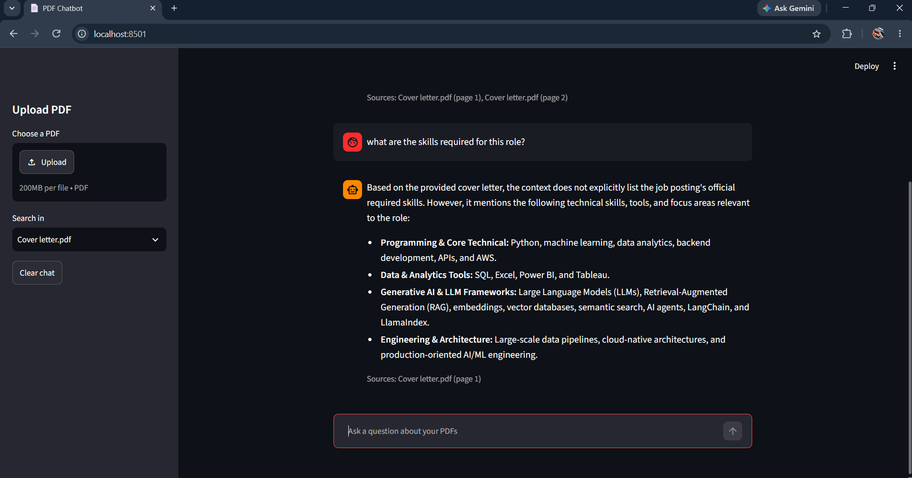

# PDF RAG Chatbot

A chatbot that answers questions from your own PDF files. Answers come only from the uploaded documents, and each answer shows the file name and page number it used.



**Live demo:** https://YOUR-APP-LINK.streamlit.app

This is a public demo. Uploaded files are shared with all visitors, so please do not upload private documents.

## Features
- Upload one or more PDFs
- Ask questions in a chat page
- Answers are based only on the document text, with sources (file and page)
- Pick one file to search in, or search all files
- Retries automatically when Gemini is busy or over its rate limit
- Runs with Docker, or directly with Python
- Includes a small evaluation script (see Evaluation below)

## Tech stack
- Python
- FastAPI (backend API)
- Streamlit (chat page)
- Gemini API (embeddings and answers)
- ChromaDB (vector database)
- Docker and Docker Compose
- Streamlit Community Cloud (live deployment)

## How it works
1. **Upload:** the PDF text is split into chunks of 800 characters, with a 150 character overlap.
2. **Embed:** each chunk is turned into an embedding with the Gemini API and stored in ChromaDB, along with its file name and page number.
3. **Ask:** the question is turned into an embedding, and ChromaDB returns the 4 most similar chunks.
4. **Answer:** Gemini writes the answer using only those chunks. If the answer is not in them, it says it could not find it.

## Run with Docker
1. Install Docker Desktop.
2. Create a `.env` file in the project folder:
   ```
   GEMINI_API_KEY=your_key_here
   ```
   You can get a free key from Google AI Studio.
3. Start the app:
   ```
   docker compose up --build
   ```
4. Open http://localhost:8501

The API runs on http://localhost:8000 (docs at `/docs`).

`streamlit_app.py` is a single-file version of the chat page that calls `rag.py` directly. It is what runs on Streamlit Community Cloud.

## Run without Docker
```
python -m venv venv
venv\Scripts\activate
pip install -r requirements.txt
```
Add the `.env` file as above, then start the two parts in separate terminals:
```
uvicorn main:app --reload
streamlit run ui.py
```

## API endpoints
| Method | Endpoint | What it does |
|--------|----------|--------------|
| POST | `/upload` | Upload a PDF and store its chunks |
| POST | `/ask` | Ask a question (optional `source` to search one file) |
| GET | `/files` | List the uploaded files |

## Project files
- `rag.py`: PDF reading, chunking, embeddings, search and answer
- `main.py`: FastAPI endpoints
- `ui.py`: Streamlit chat page
- `streamlit_app.py`: single-file chat page used for the live deployment
- `evals.py` and `eval_questions.json`: evaluation script and test questions
- `Dockerfile` and `docker-compose.yml`: container setup

## Evaluation
`evals.py` asks the chatbot every question in `eval_questions.json` (questions about The Ultimate Python Handbook) and checks the answers:
- **Questions in the PDF:** the answer must contain all the keywords listed for that question.
- **Questions not in the PDF:** the bot must say it could not find the answer.
- Results for each question are saved to `eval_results.csv`.

To run it, upload the handbook to the app locally first, then:
```
python evals.py
```

Results from my last run:

| Check | Result |
|-------|--------|
| Questions in the PDF answered correctly | X of Y |
| Questions not in the PDF handled correctly | X of Y |
| Overall | X of Y |

Keyword matching is a simple check. A correct answer written with different words can be marked wrong, so the score can be lower than the real quality.

## Limitations
- It reads only the 4 most similar chunks per question, so it cannot answer questions that need the whole document, such as counting how many times a word appears.
- Scanned PDFs (images without text) are not supported.
- The free Gemini plan allows about 100 embedding requests per minute. Large PDFs take longer because the app waits and retries when the limit is reached.